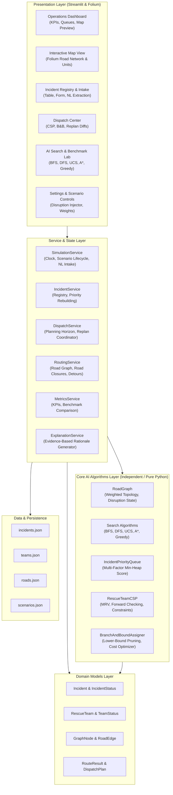
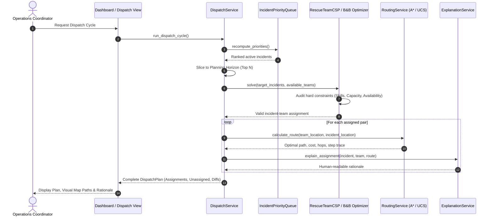

# RescueMind System Architecture

## 1. System Overview

**RescueMind: Twin Cities Animal Rescue Intelligence and Dispatch Simulator** is built using a clean, modular, layered architecture that strictly decouples the AI algorithms and domain logic from the Streamlit presentation layer.

The architecture follows domain-driven design and dependency injection principles, ensuring that algorithms can be tested, evaluated, and executed in headless environments (e.g., standard CLI or automated pytest pipelines) without any dependence on Streamlit or web session state.

---

## 2. Component Architecture Diagram

---

## 3. Data Flow & Dispatch Lifecycle

---

## 4. Architectural Guarantees & Modularity

1. **Separation of Presentation and Algorithms:**
   - No algorithmic logic (queues, BFS/UCS traversals, backtracking, lower-bound pruning) resides in the `ui/` directory.
   - Algorithms in `rescuemind/algorithms/` import only standard library modules and domain models.
2. **Deterministic Reproducibility:**
   - Tie-breaking in priority queues and CSP candidate ordering is strictly deterministic (using creation sequences and stable entity IDs), ensuring repeatable viva demonstrations.
3. **Graceful Degradation:**
   - If map tiles fail to load (e.g. offline environment), the application provides tabular route representations and network node connectivity lists.
4. **Offline Operation:**
   - The entire system operates 100% offline without API keys, cloud databases, or paid model services.
